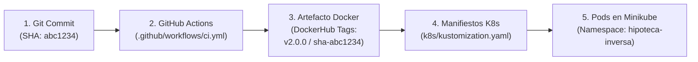

# 🔄 Estrategia GitOps y Trazabilidad de Entrega (D6)
## Proyecto: Hipoteca Inversa CL — Entrega Final DevOps

---

### 1. Definición y Principios de GitOps Aplicados

En el proyecto **Hipoteca Inversa CL**, la infraestructura y el ciclo de vida del software se gestionan bajo los principios de **GitOps**:
1. **El sistema es completamente declarativo:** Todo el entorno (Namespaces, Deployments, Services, ConfigMaps, Secrets, PVC e Ingress) está modelado en código YAML dentro del directorio `k8s/`.
2. **Git es la Única Fuente de Verdad:** No se realizan modificaciones manuales con `kubectl edit` ni comandos imperativos en producción. Cualquier cambio de configuración o imagen debe provenir de un commit rastreable en Git.
3. **Reconciliación y Convergencia:** El estado deseado en Git se compara continuamente con el estado real del cluster para corregir cualquier desviación (*drift*).

---

### 2. Cadena de Trazabilidad de Extremo a Extremo

Cada despliegue en Kubernetes puede rastrearse de forma bidireccional desde el pod en ejecución hasta el commit original en Git:



#### Tabla de Correspondencia de Trazabilidad

| Eslabón | Elemento Identificador | Cómo se Verifica en Vivo |
| :--- | :--- | :--- |
| **1. Código Fuente** | Commit SHA (Ej: `16e7689`) en rama `main` | `git rev-parse HEAD` o pestaña *Commits* en GitHub. |
| **2. Pipeline CI/CD** | Ejecución de workflow en GitHub Actions | `https://github.com/DANN-Du/Hipoteca-Inversa-CL-2025-1/actions` |
| **3. Imagen de Contenedor** | Tag semántico (`v2.0.0`) y tag por commit (`sha-16e7689`) | `docker pull dduque642/hipoteca-inversa-backend:v2.0.0` |
| **4. Manifiesto Declarativo** | `k8s/backend-deployment.yaml` versionado en Git | `cat k8s/backend-deployment.yaml` |
| **5. Pod en Kubernetes** | Imagen exacta ejecutando en el cluster | `kubectl get pod <pod-name> -n hipoteca-inversa -o jsonpath='{.spec.containers[0].image}'` |

---

### 3. Mecanismo de Detección de Desviación (Drift Detection)

Para garantizar que el cluster no sufra alteraciones no documentadas, el proyecto incluye un script de sincronización declarativa (`scripts/gitops-sync.ps1` / `scripts/gitops-sync.sh`) que ejecuta:

```bash
# 1. Comparar estado en Git contra estado en el cluster:
kubectl diff -k k8s/

# 2. Reconciliar automáticamente hacia el estado deseado:
kubectl apply -k k8s/
```

Si alguien altera un deployment manualmente en el cluster (por ejemplo, cambiando réplicas o variables de entorno), el comando de reconciliación restaura inmediatamente la configuración especificada en Git.

---

### 4. Integración con Controladores GitOps (ArgoCD / Flux)

En un entorno empresarial o cluster de producción, este repositorio está estructurado para conectarse directamente con **ArgoCD**:
* **Application Manifest de ArgoCD:**
  ```yaml
  apiVersion: argoproj.io/v1alpha1
  kind: Application
  metadata:
    name: hipoteca-inversa-app
    namespace: argocd
  spec:
    project: default
    source:
      repoURL: 'https://github.com/DANN-Du/Hipoteca-Inversa-CL-2025-1.git'
      targetRevision: HEAD
      path: k8s
    destination:
      server: 'https://kubernetes.default.svc'
      namespace: hipoteca-inversa
    syncPolicy:
      automated:
        prune: true
        selfHeal: true
  ```
* Gracias a que el directorio `k8s/` incluye `kustomization.yaml`, ArgoCD detecta la aplicación como una aplicación Kustomize nativa sin necesidad de configuración adicional.
